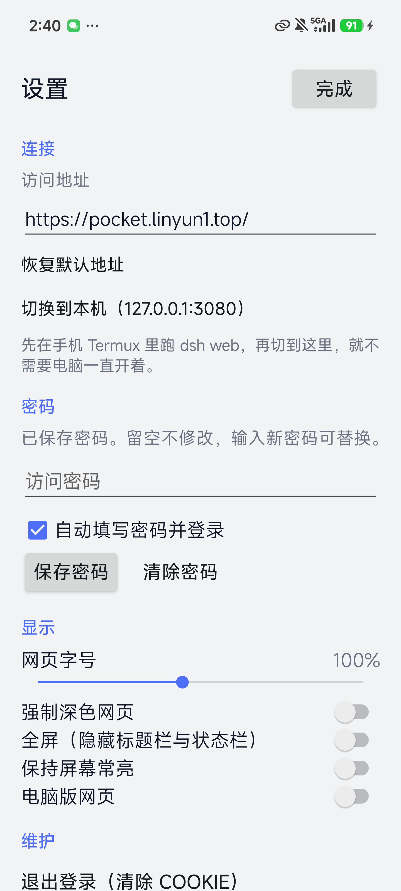

# Tsugu_official · 口袋 DSH

> 把跑在自己电脑（或手机）上的 [DSH](https://github.com/deepseek-ai/deepseek-harness) Web 工作台，封成点开就能用的 Android 原生外壳。



## 这个项目解决什么问题

DSH（DeepSeek Harness）是一个在本地运行的 AI Agent 工作台，`dsh web` 默认只监听 `127.0.0.1`。想在手机上用它，会碰到一堆琐事：

- 浏览器地址栏占掉半屏；
- 每次打开都要重新输访问密码；
- 想传一张截图或附件，网页里怎么点都没反应；
- 切到后台再回来，登录态没了。

这个 App 就是一层 WebView 壳，把这些事收掉：持久化 Cookie、密码加密存本机并自动填表、接系统文件选择器、接管下载、补状态栏和输入法高度。**除此之外它没有任何业务逻辑**——聊天、模型、工具、沙箱全都还是 DSH 自己在跑。

## 它是什么 / 不是什么

| | |
| --- | --- |
| 是 | 约 130 KB 的纯 Java WebView 壳，不依赖 AndroidX，`minSdk 26` / `targetSdk 36` |
| 是 | 一个带"连接管理"的专用浏览器：地址、密码、显示、本机启停 |
| 不是 | DSH 的替代实现，不含任何模型调用代码 |
| 不是 | 开箱即用的成品：第一次必须填**你自己的** DSH 地址和访问密码 |
| 不是 | DSH 官方客户端，与 DeepSeek / DSH 项目没有隶属关系 |

所以这个仓库的定位是"**一套可读的壳 + 一套被踩过的坑**"，不是一个装上就能聊天的 App。

## 两种运行形态

```text
① 电脑模式（默认）
   手机 App ──HTTPS / Cloudflare Tunnel──> 电脑上的 dsh web（127.0.0.1:3080）
                                            └─ DSH 本体：模型、工具、沙箱、会话

② 本机模式（电脑可以关机）
   手机 App ──> 127.0.0.1:3081（固定入口：redirect.js 读当前 token 后 302）
                  └─> 127.0.0.1:3080（dsh web，跑在 Termux 的 proot Ubuntu 里）
```

为什么非要 3081 这一层：`dsh web` 的访问 token 是**每个进程随机生成**的，重启就变，写死在 App 里第二天就失效。`redirect.js` 每次请求时读 `~/dsh-token.txt` 里当前的 token 再跳转，于是 App 只需要记一个固定的 `http://127.0.0.1:3081/`。

## 功能

| 功能 | 说明 |
| --- | --- |
| 免登录 | WebView 持久化 Cookie，登录一次可保持 30 天（服务端 `Max-Age=2592000`） |
| 密码保存 | 首次启动弹窗保存访问密码；用 Android Keystore 的 AES/GCM 密钥加密，只存本机 |
| 自动填表 | 打开登录页时自动填入密码并提交；手动登录一次后也会自动记住 |
| 抽屉 | 屏幕左缘右滑或点左上角 ☰：刷新 / 后退 / 前进 / 回到首页 / 全屏 / 常亮 / 设置 / 关于 |
| 显示 | 网页字号 60%–150%、强制深色（CSS 反色）、全屏、电脑版 UA |
| 附件 | `onShowFileChooser` 接系统文件选择器 |
| 权限 | 页面请求麦克风 / 摄像头时弹系统授权 |
| 下载 | 走系统 DownloadManager，并带上登录 Cookie |
| 错误页 | 断网、域名错、连接被拒、超时分别给提示，网络恢复后自动重载 |
| 本机 DSH | 设置页显示 3081 / 3080 是否在监听，并可"一键启动 / 一键停止"（经 Termux 的 `RUN_COMMAND`） |
| 模式切换 | 菜单里一键在"电脑模式"和"本机模式"之间切换 |

## 环境要求

- **JDK 21**（Android Studio 自带的 JBR 即可；系统默认的 Java 8 编译不了 AGP 8.x）
- **Android SDK**：Platform 36 + Build-Tools 36.0.0
- **Gradle 8.14.x**（AGP 8.13.2）

## 构建

```powershell
$env:ANDROID_HOME = "$env:LOCALAPPDATA\Android\Sdk"
gradle -p . assembleDebug      # 调试包，可直接装
gradle -p . assembleRelease    # 正式包
```

产物在 `app/build/outputs/apk/` 下。

关于签名：仓库里**不含**任何密钥。想打正式包，复制 `keystore.properties.example` 为 `keystore.properties`，填四个字段，并把 `.jks` 放进 `keystore/`（这两个路径都已写进 `.gitignore`）。不填也能构建，只是产出未签名包。升级安装必须用同一份 keystore，否则会提示签名冲突。

关于 JDK：`gradle.properties` 里的 `org.gradle.java.home` 指向本机 Android Studio 的 JBR 路径。你机器上没有这个路径的话，删掉那一行，改用 `JAVA_HOME` 指向 JDK 21 即可。

## 第一次使用

1. 装好 APK；
2. 让 DSH 在手机上可达：电脑上跑 `dsh web`，再用 Cloudflare Tunnel（或任意内网穿透）暴露成一个 HTTPS 地址；
3. 首次打开 App 会直接跳到设置页（源码里不预设任何地址）→ **访问地址** 填你自己的地址；
4. 填**访问密码**（就是 DSH 那层的密码，不是模型 API Key），可勾选保存；
5. 打开"自动填写密码并登录"，以后点开 App 就是已登录状态。

模型、Agent、工具、沙箱这些配置**全部在 DSH 里做**，这个 App 不碰。

## 本机模式（可选，电脑可以关机）

目标：手机上自己跑 DSH，App 连 `127.0.0.1`。链路：

```text
Tsugu_official (WebView)
  └─ http://127.0.0.1:3081/          ← 固定入口（node redirect.js）
       └─ http://127.0.0.1:3080/?token=…   ← dsh web
            └─ Termux → proot-distro → Ubuntu 24.04 → node 24 → dsh
```

一次性准备：

1. Termux 里装 `proot-distro` 和 Ubuntu 24.04。国内从 Docker Hub 拉镜像基本不通，用清华的 ubuntu-base tarball 手工装，rootfs 放到 `$PREFIX/var/lib/proot-distro/installed-rootfs/ubuntu`；
2. Ubuntu 里装 node 24 与 `@deepseek-ai/dsh`。npm 12 默认拦截 install scripts，`node-pty` / `koffi` 不会编译，必须先装 `build-essential python3 pkg-config`，再用 `--allow-scripts=...` 重装（`scripts/phone-fix.sh` 里是完整命令）；
3. 把 `scripts/phone-redirect.js` 拷成 `~/redirect.js`，`scripts/phone-setup-all.sh` 拷成 `~/all.sh`；
4. 设置页点"切换到本机"；
5. 以后在设置页点"一键启动"即可（需在 Termux 执行过一次 `echo allow-external-apps=true >> ~/.termux/termux.properties` 并重开 Termux）。

踩过的坑（按顺序）：

1. Termux 原生 npm 装 dsh 不可行：`node-addon-require-builtin` 只有 linux/darwin/win32 预编译，也没有 `binding.gyp` 可自编译 → 必须走 proot 的 glibc 环境；
2. Termux 自带 `libc++ 27c` 太旧，node 24 报 `cannot locate symbol __ZNSt6__nd113__hash_memoryEPKvm` → `pkg upgrade -y`；
3. proot-distro 5.x 从 Docker Hub 拉镜像国内不通（见上）；
4. npm 12 拦 install scripts（见上）；
5. Termux 没有 Linux 沙箱后端，DSH 执行命令会要求 `danger-full-access` 审批 → 在 App 里把访问模式切到"完全权限"。

## 目录结构

```text
app/src/main/java/top/linyun1/dshpocket/
  MainActivity.java     WebView 外壳：抽屉、自动登录注入、文件选择、下载、返回键、断网重试
  SettingsActivity.java 地址 / 密码 / 显示 / 维护 / 本机一键启停
  Prefs.java            SharedPreferences 封装（tsugu_prefs）与地址记忆（地址留空＝未配置）
  PinStore.java         Android Keystore AES/GCM 加密存密码
  PhoneDsh.java         通过 Termux 的 RUN_COMMAND 服务启停本机 DSH
app/src/main/res/       布局、图标、文案（values/strings.xml）
scripts/                Termux 侧脚本：redirect.js、启动、修复、收尾
```

## 已知限制

- **没有在真机上完整回归过**。开发机没有安卓设备也没有 system-images，只做了编译与静态校验（签名、manifest、资源、`aapt2 dump badging`）。
- 自动登录依赖服务端的登录页结构（`form[action*="pocket-login"]`、密码框、Cookie 名）。服务端一改就失效；此时手动输一次密码会重新捕获。
- "强制深色"是给网页套 `filter: invert()`，图片会一起反色，属于够用级别。
- 没做网页内拍照上传，只能从相册/文件里选。
- 本机模式的脚本依赖 Termux 的 `$HOME` 布局，不是通用发行版。

## 隐私

- 不收集任何统计，不请求任何第三方 SDK；
- 访问密码只用 Android Keystore 加密后存在本机，不上传；
- 本仓库不含签名密钥、不含本机 SDK 路径、不含内网地址（`keystore.properties`、`local.properties`、`AGENTS.md` 均已忽略）。

## 版本

当前 `1.1.0`（`versionCode 18`）。

`1.1.0` 的变更：源码里不再预设任何域名——访问地址由使用者首次启动时自己填（`Prefs.DEFAULT_URL` 为空串，首次启动直接跳设置页）；"关于"里的版本号改为读 `BuildConfig.VERSION_NAME`，不再手写死。

## 许可

[MIT](LICENSE)
